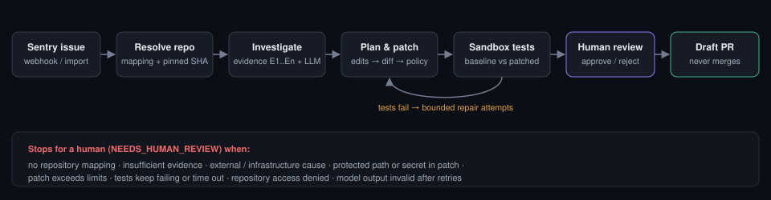

# Patchora

Patchora investigates production errors reported by **Sentry**, finds the responsible code in the
mapped **GitHub** repository, asks a **Groq**-hosted LLM for an evidence-backed diagnosis and a minimal
patch, validates the patch by running tests in a **disposable Docker sandbox**, and — only when policy and
(by default) a human reviewer allow it — opens a **draft pull request**.

It never pushes to a default branch, never merges, never deploys, and prefers abstaining over guessing.



## Features

- **Sentry intake** — signed webhooks (HMAC-SHA256, idempotent per delivery) or manual import; live issue
  browsing; issue → repository mapping with path-prefix rewriting.
- **Deterministic investigation first** — application stack frames are mapped to files at the *pinned*
  revision (the release commit when Sentry knows it, otherwise an explicitly labeled branch head); bounded
  excerpts, related tests, definitions and call sites are collected as numbered evidence (`E1`, `E2`, …).
  Mismatches between the repository and the code Sentry captured are flagged.
- **Structured, validated model output** — diagnosis, patch plan, patch and failure analysis are Pydantic
  schemas; hypotheses must cite collected evidence; invalid output is re-requested a bounded number of times.
- **Policy gates in code** — evidence sufficiency, plan scope, protected paths (CI, deployment, secrets,
  manifests), size limits, path traversal/symlink/binary/mode checks, secret scanning, repository allowlist.
- **Real validation** — baseline (base + new tests) vs patched runs in network-less, read-only, non-root
  containers with CPU/memory/PID/time limits; regressions detected by comparing failing test ids; a
  diagnosis is only "supported by tests" when a test fails before the fix and passes after it.
- **Durable workflow** — a 22-state machine persisted in SQLite after every step; resumes after crashes
  without repeating non-idempotent GitHub writes; SQLite-backed job queue with leases.
- **Autonomy modes** — A (analyze only), **B (prepare patch, approval required — default)**, C (automatic
  draft PR only when the failure is reproduced and fixed, risk is low and `AUTO_CREATE_PULL_REQUESTS=true`).
- **Dashboard** — Next.js (App Router, strict TypeScript, Tailwind): overview, issues, repositories, live
  run timelines over SSE, syntax-highlighted diff review, approvals, pull requests, evaluations,
  integrations, settings and the append-only audit log.
- **Demo mode** without any credentials, clearly labeled and isolated from real data.
- **Evaluation harness** with a labeled synthetic dataset and measured metrics.

## Architecture (short)

```
Sentry ──webhook/API──▶ FastAPI ──▶ SQLite (runs, steps, events, jobs, audit)
                          │                ▲
                          ▼                │ durable state after every step
                    Worker pool ──▶ Workflow engine ──▶ Groq (structured JSON, untrusted-data framing)
                                         │        ├──▶ GitHub (contents, tarball, branch/PR via Git Data API)
                                         │        └──▶ Docker sandbox (setup ▸ baseline ▸ patched ▸ static)
Next.js dashboard ◀──REST + SSE (same-origin proxy)──┘
```

## Prerequisites

- Python **3.12**
- Node.js **20+** and npm
- Docker (Desktop or Engine) — required only to *execute* repository tests safely. Without it, the app runs
  investigation and patch preview and disables execution and publication.

## Quick start

```bash
# Linux / macOS
python3.12 -m venv .venv && .venv/bin/pip install -e ".[dev]"
cd frontend && npm ci && cd ..
.venv/bin/python backend/scripts/init_db.py
.venv/bin/python -m uvicorn app.main:create_app --factory --app-dir backend --port 8000   # terminal 1
cd frontend && npm run dev                                                                  # terminal 2
```

```powershell
# Windows (PowerShell)
powershell -ExecutionPolicy Bypass -File dev.ps1 install
powershell -File dev.ps1 init-db
powershell -File dev.ps1 backend     # terminal 1
powershell -File dev.ps1 frontend    # terminal 2
```

Open http://localhost:3000. The backend serves the API at http://127.0.0.1:8000/api/v1 (OpenAPI docs at
`/api/v1/docs`). Background workers run inside the backend process.

## Demo (no credentials)

On the **Overview** page choose a scenario under *Run a demo scenario* and press **Start demo run**, or:

```bash
curl -X POST localhost:3000/api/v1/demo/runs -H 'X-Requested-With: patchora' \
     -H 'Content-Type: application/json' -d '{"scenario":"zero-division"}'
```

Demo runs use synthetic Sentry issues, a bundled fixture repository, scripted model responses, simulated
test results and simulated publication — every one of these is labeled in the UI and nothing leaves your
machine. Scenarios: a fixable `ZeroDivisionError`, a missing-null-check `AttributeError`, an external
timeout (the agent abstains), and a prompt-injection attempt (blocked by policy).
Reset with `python backend/scripts/create_demo_data.py --reset`.

## Configuration

**No `.env` file is needed.** Every integration value — API keys, tokens, model id, organization/project,
GitHub App id / installation id / private key, webhook secrets, service URLs — is entered on the
**Integrations** page, stored in the Patchora database (`data/patchora.db`) and read from there at use time
(no restart). Policy settings (autonomy mode, limits, protected paths, sandbox backend) live on the Settings
page. Both are admin-only and audited.

| Integration | Minimum fields on the Integrations page |
| --- | --- |
| Groq | API key, Model id (Test connection lists the models available to your key; click one to select it) |
| Sentry | Auth token (event:read, project:read, org:read), Organization slug; Project slug to browse; Webhook client secret for webhooks |
| GitHub | GitHub App id + Installation id + App private key (PEM) — or a fine-grained Personal access token |

> Values are stored **unencrypted** unless `APP_SECRET_KEY` is set (then they are encrypted at rest). Protect
> `data/patchora.db`. Key management and rotation are planned. Environment variables
> ([.env.example](.env.example)) still work as an optional fallback when a field has no saved value.

Then connect a repository on the **Repositories** page, enable it (allowlist) and map the Sentry project to it.

## Tests and quality checks

```bash
.venv/bin/python -m pytest backend/tests -q        # no credentials required
.venv/bin/python -m ruff check backend && .venv/bin/python -m mypy
cd frontend && npm run lint && npm run typecheck && npm run build
.venv/bin/python -m app.evaluation.evaluator --llm scripted --sandbox auto   # evaluation report in data/eval_reports
```

The Docker sandbox test runs when a Docker daemon is reachable and is skipped otherwise. FAISS tests run when
the optional `faiss` extra is installed.

## Security limitations (read before using with real repositories)

- **Isolation depends on Docker.** Containers run without network, as non-root, read-only, with resource
  limits and no credentials — but a container is not a VM; kernel-level escapes are out of scope. The
  `local` runner is *not* a sandbox and is refused outside development.
- **Dependency installation** runs in a separate networked container (binary wheels only, `npm ci
  --ignore-scripts`), which still downloads third-party packages.
- **Prompt injection** is mitigated (untrusted-data framing, schema validation, code-enforced scope, policy
  checks, human approval) but the model can still produce a plausible wrong fix — that is why approval is the default.
- **SQLite and the in-process worker pool are for a single instance.** Move to
  PostgreSQL and an external queue for multi-instance deployments.
- `AUTH_MODE=local` is a single-user development mode (loopback only); use `AUTH_MODE=token` elsewhere and
  put the app behind HTTPS.

## Repository layout

```
backend/app/        FastAPI app: api/, agent/ (state machine, nodes, policies, prompts), services/
                    (sentry, github, groq, patch, validation, investigation, search), sandbox/, workers/,
                    security/, db/ (models + Alembic migrations), demo/, evaluation/
backend/tests/      unit, integration, security and evaluation tests
backend/scripts/    init_db, create_demo_data, create_user, check_integrations, faiss_index, export_openapi
frontend/           Next.js dashboard (types generated from the OpenAPI schema: npm run gen:api)
```

## License

MIT — see [LICENSE](LICENSE).
